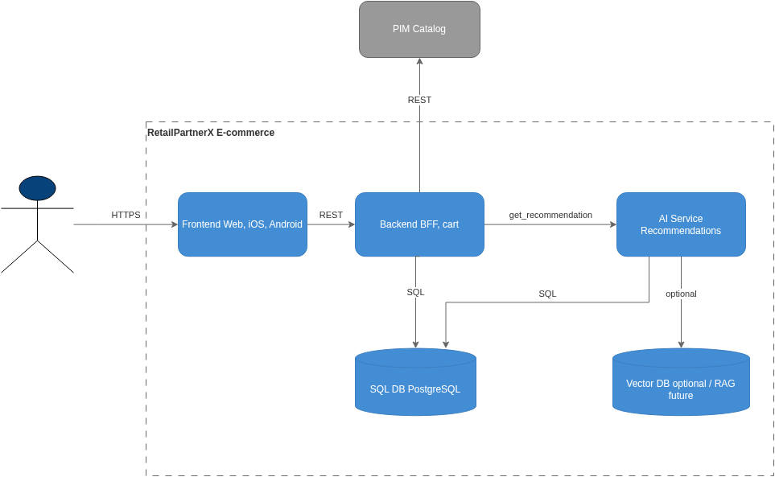
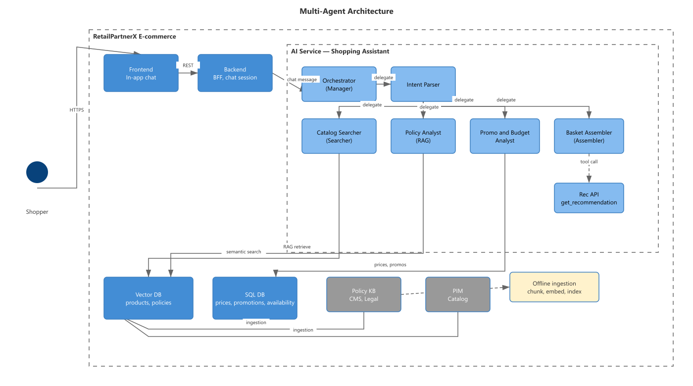

# RetailPartnerX — AI Architecture Case Study

> Educational architecture case study: personalized recommendations and a shopping assistant for an FMCG retailer

**HTML presentation:** [GitHub Pages](https://yuesit17.github.io/yuit-docs-ai-architect/portfolio/) · **GitHub:** [YuesIt17/yuit-docs-ai-architect](https://github.com/YuesIt17/yuit-docs-ai-architect)

---

## Project Overview

**RetailPartnerX** is a fictional FMCG retailer with omnichannel sales. The client states the goal as "personal recommendations like Tesco / Carrefour", but without KPIs, data boundaries or channels. The case works through the architecture of an AI-native system: from the program and risks to C4, API, agentic RAG, data pipeline, production readiness and inference capacity / cost.

The repository evolves step by step through course modules (`hw-1` … `hw-7`) as a single architecture case study. The physical folder names are kept for the course submission process.

**What is here:** architecture design, a LangGraph prototype (stub, no API keys), experiments and coursework. **What is not here:** a production deployment, real load, a running Kafka / Vector DB / observability stack.

---

## Architecture Focus

| Area | Essence |
|-------------|------|
| **Program & Risk** | Discovery, PoC→MVP→Prod contract, AI risks R1–R8, roadmap with DoD |
| **System Design (C4)** | System boundaries, containers, AI Service components, sequence flows |
| **Integration (OpenAPI)** | Backend ↔ AI Service contract: `POST /get_recommendation` |
| **Agentic RAG** | Supervisor multi-agent, dual KB (Product + Policy), LangGraph prototype |
| **Architecture Decisions** | ADR-001: SaaS LLM for PoC/MVP via LLM Client abstraction |
| **Data Architecture** | Kafka → Spark → S3 → Feature Store / Vector DB, anti-skew governance |
| **Production Readiness** | Security layer, RAG evaluation strategy, observability dashboard design |
| **Capacity & Cost** | VRAM/GPU sizing Llama-3-70B @ 1000 RPM; Yandex / Cloud.ru / AWS / GCP; INT4 + vLLM |

---

## Architecture at a Glance

| Element | Description |
|---------|----------|
| **Boundaries** | Frontend → Backend (BFF) → AI Service; external systems: PIM, CDP/CRM |
| **Storage** | SQL DB (history, catalog), Redis (candidate cache), Vector DB (RAG) |
| **AI Service** | Ranker → Top-K → RAG + LLM re-rank; synchronous response on the product page |
| **Trust boundary** | The Backend knows no ML details — only the OpenAPI contract |
| **NFR** | p95 latency as the metric class (numeric SLO — after MVP measurements, see [hw-2/diagrams/README.md](hw-2/diagrams/README.md)) |

Shopping assistant in the app chat: the Orchestrator coordinates 6 specialized agents; the Policy Analyst is a semantic guard over the Policy KB; the Basket Assembler reuses the recsys API from hw-2.

---

## Architecture Journey

| Module | Architecture focus | Main artifacts |
|--------|---------------------|-------------------|
| [hw-1](hw-1/) | Program, risks, roadmap | [RetailPartnerX_AI_Strategy.md](hw-1/RetailPartnerX_AI_Strategy.md) |
| [hw-2](hw-2/) | C4, Sequence, API contract | [diagrams/](hw-2/diagrams/), [recommendation-api.yaml](hw-2/openapi/recommendation-api.yaml) |
| [hw-3](hw-3/) | Agentic RAG, multi-agent, prototype | [agents.md](hw-3/docs/agents.md), [rag-pipeline.md](hw-3/docs/rag-pipeline.md), [code/](hw-3/code/) |
| [hw-4](hw-4/) | ADR: LLM hosting | [adr-001-llm-hosting.md](hw-4/docs/adr-001-llm-hosting.md) |
| [hw-5](hw-5/) | Data pipeline, Feature Store | [data-pipeline.md](hw-5/docs/data-pipeline.md), [diagram](hw-5/diagrams/data-pipeline.png) |
| [hw-6](hw-6/) | Security, Evaluation, Observability | [quality-assurance.md](hw-6/docs/quality-assurance.md), [security-layer.png](hw-6/diagrams/security-layer.png) |
| [hw-7](hw-7/) | Inference sizing & cloud cost | [inference-sizing.md](hw-7/docs/inference-sizing.md), [recommendation.md](hw-7/docs/recommendation.md) |

---

## Key Architecture Decisions

| Decision | Context / Trade-off | Evidence |
|---------|---------------------|----------|
| **AI Service as a separate container** | Independent ML/LLM release and scaling vs a network hop | [hw-2/diagrams/README.md](hw-2/diagrams/README.md) §1 |
| **Ranker → Top-K → RAG/LLM** | Latency and cost control vs running the LLM on the full catalog | [hw-2/diagrams/README.md](hw-2/diagrams/README.md) §2, assumption A-001 |
| **Supervisor multi-agent (6 agents)** | SRP, Policy Analyst isolation vs a monolithic prompt | [hw-3/docs/agents.md](hw-3/docs/agents.md) |
| **SaaS LLM for PoC/MVP** | TTM and quality vs data residency / vendor lock-in | [hw-4/docs/adr-001-llm-hosting.md](hw-4/docs/adr-001-llm-hosting.md) |
| **Dual KB RAG (Product + Policy)** | Different retrieval strategies vs mixing in a single index | [hw-3/docs/rag-pipeline.md](hw-3/docs/rag-pipeline.md) |
| **Kafka → Spark → Feature Store** | Training-serving consistency vs pipeline complexity | [hw-5/docs/data-pipeline.md](hw-5/docs/data-pipeline.md) |
| **Security Layer before the LLM** | PII, prompt injection, output guardrails vs latency overhead | [hw-6/docs/quality-assurance.md](hw-6/docs/quality-assurance.md) §1 |
| **Self-hosted INT4 + vLLM (2×A100)** | OpEx @ 1000 RPM vs FP16 / extra replicas; RU cloud vs AWS/GCP | [hw-7/docs/inference-sizing.md](hw-7/docs/inference-sizing.md) |

---

## Production Readiness

| Area | Status | What is covered | Evidence |
|---------|--------|------------|----------|
| **Security** | Architecture design | PII Sanitizer, Input/Output Guardrails, Secret Manager, OWASP LLM | [hw-6](hw-6/docs/quality-assurance.md) |
| **Reliability** | Architecture design + Studied | OpenAPI 503, graceful degradation in the strategy, timeout/retry patterns | [hw-2 OpenAPI](hw-2/openapi/recommendation-api.yaml), [hw-1](hw-1/RetailPartnerX_AI_Strategy.md) |
| **Evaluation** | Planned | Faithfulness, Answer Relevancy; Ragas / DeepEval CI gates | [hw-6 §2](hw-6/docs/quality-assurance.md) |
| **Observability** | Planned | Prometheus, Tempo, Langfuse, Grafana dashboard spec | [hw-6 §3](hw-6/docs/quality-assurance.md) |
| **Data** | Architecture design | Ingestion, Feature Store, anti-skew, index versioning | [hw-5](hw-5/docs/data-pipeline.md) |
| **Capacity / Cost** | Architecture design | VRAM + KV, GPU fit, comparison of 4 clouds, INT4/vLLM | [hw-7](hw-7/docs/inference-sizing.md) |
| **Platform** | Not implemented | Deployment, K8s, CI/CD — outside the repository scope | — |

---

## Enterprise / Retail Context

The architecture patterns of this case apply to enterprise retail problems:

- **Product recommendations** — a "Frequently bought with" block on the SKU page with a controlled latency budget
- **Shopping assistant** — conversational commerce with constraint parsing (allergens, budget, promotions)
- **Policy compliance** — RAG over internal policies (GDPR, 18+, allergens) as a semantic guard
- **Knowledge freshness** — a data pipeline that keeps the Product KB and embeddings up to date
- **Inference capacity** — GPU sizing and TCO of a self-hosted LLM at a target RPM (the trigger for revisiting the SaaS ADR)

This is an educational case; the patterns are described as an architecture approach, not as a description of real internal systems.

---

## Project Status

RetailPartnerX is an **educational architecture case study** developed as part of the AI Architect program.

The repository contains:

- architecture design (C4, ADR, data pipeline, security/eval/observability, inference sizing)
- a LangGraph prototype (stub, keyword RAG, 7 pytest tests, no LLM API keys)
- coursework artifacts in `hw-*`

The goal is hands-on work on the architecture of AI-native systems and production-oriented trade-offs. **The project is not a production deployment.**

---

## Author

**Eugene Yulov** · [LinkedIn](https://www.linkedin.com/in/eugene-yulov/)

Engineering Manager with 13+ years of experience in IT / software development.

Professional focus:

- Solution Architecture
- Distributed Systems
- Platform Engineering
- AI Architecture (a growing specialization built on a system engineering background)

---

## Navigation

| Resource | Description |
|--------|----------|
| [portfolio/index.html](https://yuesit17.github.io/yuit-docs-ai-architect/portfolio/) | HTML presentation for architecture review (GitHub Pages) |
| [hw-1 … hw-7](#architecture-journey) | Evidence by module |
| [docs/interview/INTERVIEW-SUMMARY.md](docs/interview/INTERVIEW-SUMMARY.md) | Short interview cheat sheet |
| [docs/interview/ARCHITECTURE-INTERVIEW-CHEATSHEET.md](docs/interview/ARCHITECTURE-INTERVIEW-CHEATSHEET.md) | General Solution Architect topics |
