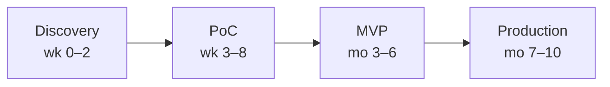
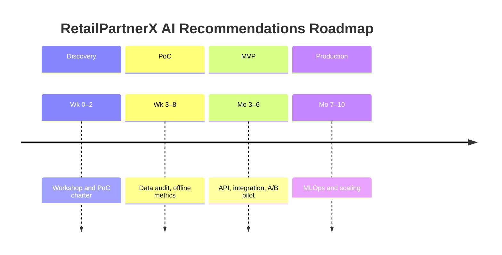

# AI Recommendations Adoption Strategy for RetailPartnerX

> **Abbreviations:** [Glossary of abbreviations](Glossary.md) (T&M, FP, NDCG@10, SLA, etc.)

**Document for alignment with the client**  
Role: solution architect, systems integrator  
Version: 1.0

---

## Executive Summary

**RetailPartnerX** is an international grocery retail company operating store chains. The client wants a personalized recommendation system but states the requirements as "we want it like Tesco / Carrefour / X5 Digital", without specific KPIs, data boundaries or channels.

Proposed approach:

1. Remove uncertainty through **5–7 clarifying questions** and a discovery workshop.
2. Run a **PoC** on a **T&M with cap** model (4–6 weeks).
3. Move to an **MVP** on a **hybrid model** (FP for integrations and UI, T&M for ML/data).
4. Scale to **Production** with a framework FP/SLA and an MLOps retainer.
5. Manage **AI-specific risks** through a matrix and a mitigation plan.

Program horizon: **~10 months** to a stable production environment.

---

## 1. Context and Assumptions

| Parameter | Value |
|----------|----------|
| Client | RetailPartnerX |
| Goal | Personalized product recommendations |
| Initial requirements | Vague, FMCG retail benchmark (Tesco, Carrefour, X5 Digital) |
| Channels (assumption) | Website, app, email/push (to be clarified) |
| Integrator team | Architect, ML, data, backend, QA |
| Regulation | GDPR, 152-FZ (Russia), consent to personal data processing |

---

## 2. Clarifying Questions for the Client (Removing Uncertainty)

| # | Question | Why we ask | Project impact |
|---|--------|--------------|-------------------|
| 1 | **Which KPIs define success?** (recommendation block CTR, conversion to cart/order, AOV, share of revenue from recommendations, retention) | Without metrics we cannot close the PoC or sign the MVP FP | PoC/MVP DoD, contract, scenario prioritization |
| 2 | **Where do we show recommendations?** (home page, product page, cart, catalog, push/email) | Defines the integration scope and load | MVP/Prod roadmap, FP estimate |
| 3 | **What data is available?** (click/view/cart/purchase events, unified customer ID, offline→online, history depth) | Data quality is the main AI risk in retail | PoC: go/no-go; feature store architecture |
| 4 | **How do we handle cold start?** (new users, guests, new SKUs, regions) | Affects the choice of algorithms and baseline | MVP: fallback scenarios; coverage metrics |
| 5 | **Which systems are in scope?** (PIM/catalog, CMS, CDP, CRM, anti-fraud, search) | Integration boundaries and each party's responsibilities | FP scope, CR triggers |
| 6 | **NFR and compliance:** latency (p95), SLA, explainability, GDPR / 152-FZ, log retention | Production-readiness requirements | Prod DoD, compliance risks |
| 7 | **Who owns the product and how do we accept the model?** (Product owner, acceptance committee, A/B policy) | Governance and release speed | Contract, MVP pilot stage |

**Next step:** a 1–2 day workshop with RetailPartnerX → completed answer matrix → refined PoC SOW.

---

## 3. Contract Model

### 3.1. Level of Uncertainty

| Factor | Status |
|--------|--------|
| Business KPIs | Not defined |
| Channel scope | Partial |
| Data quality/completeness | Not verified |
| ML architecture | Not chosen |
| FMCG benchmark (Tesco / Carrefour / X5) | Not decomposed |

**Conclusion:** uncertainty is **high** → pure FP for the whole project is **not recommended**.

### 3.2. Model by Stage

| Stage | Model | Scope (brief) | Benefit to RetailPartnerX | Benefit to the integrator |
|------|--------|----------------|------------------------|---------------------|
| **PoC** | **T&M with cap** (budget and time ceiling) | 1–2 scenarios, historical data, offline metrics, go/no-go report | Pays for testing a hypothesis, not for a "black box"; cap control | Bears no risk of a wrong FP estimate; iteration flexibility |
| **MVP** | **Hybrid:** FP for the fixed integration and UI scope + **T&M** for ML/data | 1 channel in prod, A/B or shadow, monitoring, baseline | Predictability for the "boxed" part; flexibility where the model iterates | Fair risk distribution; margin on the FP part |
| **Production** | **Framework FP** for the platform + **SLA** + **T&M retainer** for retraining/improvements | All key touchpoints, MLOps, SLO | Stable operation and scale | Long-term support, CRs for changes |

### 3.3. Why Not Pure FP at the Start

- The volume cannot be fixed without a data audit and pilot metrics.
- AI projects need iteration; FP without CRs leads to scope conflicts.
- A capped PoC reduces the financial risk for both parties.

### 3.4. Draft Change Request (for the FP Parts of MVP/Prod)

**A CR is initiated** if:

1. A new event source is added or the customer ID schema changes.
2. Target KPIs change (±1 primary metric).
3. **>2** new touchpoints or channels are added.
4. Catalog/SKU volume grows **>30%** without an agreed retrain pipeline.
5. Latency/SLA requirements tighten by **>20%** from the agreed baseline.
6. New regulatory requirements appear (GDPR, 152-FZ, cross-border data).

**Process:** request → impact assessment (person-days, risk) → approval of additional budget/time → SOW amendment.

---

## 4. Risk Assessment

The assessment is **qualitative** (L / M / H scale), following the risk matrix method from the course materials (`docs/Risk_Matrix_Example.xlsx`).

### 4.1. What P and I Mean

| Indicator | Full name | What we assess | How it is used in this document |
|------------|-----------------|---------------|------------------------------|
| **P** | Probability | How **likely** the risk is to materialize at this project stage | Row of the 3×3 matrix (§4.3) |
| **I** | Impact | How **serious the consequences** are for the business if the risk occurs | Column of the 3×3 matrix (§4.3) |
| **Level** | Risk priority | The result for mitigation planning: **L** — monitor, **M** — control, **H** — active mitigation | Cell at the intersection of P and I; **not** the arithmetic mean of P and I |

**L / M / H scale — criteria for P (probability):**

| Value | Criterion (likelihood of occurrence) |
|----------|-----------------------------------|
| **L** | Unlikely given the measures taken; no typical precursors in the industry |
| **M** | Realistic without special measures; seen in similar AI projects |
| **H** | High probability by default at this stage; almost inevitable without mitigation |

**L / M / H scale — criteria for I (impact):**

| Value | Criterion (business consequences) |
|----------|-------------------------------------|
| **L** | Local failure with no effect on KPIs or compliance |
| **M** | UX degradation, release delays, additional rework costs |
| **H** | Missed KPIs, reputational damage, fines, pilot shutdown |

### 4.2. Rationale for the Risk Scores (Basis of Estimate)

The P and I scores in the §4.4 register are a **preliminary expert estimate** at the pre-discovery stage. They are not actual RetailPartnerX metrics (the data audit and workshop are still ahead).

| Source of rationale | What the estimate takes into account |
|--------------------|---------------------|
| **Project assumptions (§1)** | Vague requirements, FMCG, omnichannel, GDPR/152-FZ regulation |
| **Stage context** | PoC — focus on data; MVP — pilot and cold start; Prod — drift, load, MLOps |
| **Industry patterns** | Typical recsys risks in grocery/FMCG (event quality, cold start, SKU seasonality) |
| **Integrator practice** | Accumulated experience of AI rollouts in retail before measurements start at the client |
| **Course method** | The 3×3 matrix format and qualitative scale from `Risk_Matrix_Example.xlsx` |

**Status of the estimates:** *Draft — subject to validation* after the workshop (§2) and the data audit in the PoC; if assumptions change, P/I and levels are recalculated and, if needed, a quantitative assessment is done (§4.5).

### 4.3. Qualitative 3×3 Matrix

Cell legend: **L** — low priority, **M** — medium, **H** — high (requires a mitigation plan).

| P \\ I | Low impact (I=L) | Medium impact (I=M) | High impact (I=H) |
|--------|--------------------------|---------------------------|---------------------------|
| **Low probability (P=L)** | L | M | M |
| **Medium probability (P=M)** | M | M | **H** |
| **High probability (P=H)** | M | **H** | **H** |

**How to get the "Level" of a risk:** find the cell at the intersection of row P and column I. Example: R1 has P=**M**, I=**H** → cell **H**; R6 has P=**L**, I=**H** → cell **M** (low probability, but high damage if an incident occurs).

### 4.4. Risk Register (AI-Specific)

| ID | Risk | P | I | Level | Mitigation | Owner | Stage |
|----|------|---|---|---------|-----------|----------|------|
| R1 | Low quality/completeness of behavioral data | M | H | **H** | Data audit in the PoC; unified customer ID; agreement on events | Data Lead RetailPartnerX | PoC |
| R2 | Cold start: new users and SKUs | H | M | **H** | Popularity + content-based fallback; rules for guests | ML Architect | MVP |
| R3 | Model degradation (concept/data drift) | M | H | **H** | Online/offline metric monitoring; retrain procedure | MLOps | Prod |
| R4 | Irrelevant/"toxic" recommendations (reputation, compliance) | M | H | **H** | Category filters, blocklists, human-in-the-loop in the pilot | Product + Legal | MVP |
| R5 | Inference latency at peak (sales events) | M | M | **M** | Cache, batch features, autoscaling, load tests | Platform | Prod |
| R6 | Non-compliance with GDPR / 152-FZ / missing consent | L | H | **M** | Privacy review; personal data minimization; pseudonymization; DPIA by jurisdiction | Legal / Security | PoC–Prod |
| R7 | Vendor lock-in of an external LLM/API (if genAI is used) | M | M | **M** | Provider abstraction; self-hosted option in the roadmap | Architect | MVP |
| R8 | Hallucinations / factual errors of genAI (product descriptions, chat assistant) | M | M | **M** | No auto-publishing without validation; templates + human review; guardrails and blocklists | Product + ML | MVP–Prod |

**Priority summary:** the four **H**-level risks (R1–R4) are the mitigation focus in the PoC/MVP; the four **M**-level risks (R5–R8) are controlled as the system moves to prod and when genAI is used.

### 4.5. Quantitative Assessment (Next Step)

After the workshop, we recommend moving the top 5 risks into a quantitative register (ISAR template: probability %, min/expected/max damage, tolerance limit).

---

## 5. Roadmap

### 5.1. Milestone Summary

| Milestone | Timing | Goal | Key deliverables | DoD (success criteria) | Contract |
|------|------|------|----------------------|------------------------|----------|
| **Discovery** | Wk 0–2 | Align on the §2 questions | Answer matrix, refined scope | PoC charter signed | T&M / internal |
| **PoC** | Wk 3–8 | Test the value hypothesis | Pipeline on historical data; 1–2 scenarios; offline report | NDCG@10 / HitRate@10 ≥ the agreed baseline **or** an explicit no-go with reasons | T&M with cap |
| **MVP** | Mo 3–6 | Reach users | Recommendations API; integration into 1 channel; A/B or shadow; dashboard | Statistically significant lift on the primary KPI **or** parity + an improvement plan; no critical incidents for 2 weeks | Hybrid FP+T&M |
| **Production** | Mo 7–10 | Scaling | All key touchpoints; MLOps (retrain, alert); SLO | p95 latency ≤ target; uptime ≥ SLA; drift alerts are handled | FP + SLA + retainer |

### 5.2. Definition of Done by Stage

#### PoC
- [ ] Data audit: event coverage, % of identified users.
- [ ] Offline metrics on a hold-out: **NDCG@10**, **HitRate@10**, coverage.
- [ ] Comparison with a rule-based baseline.
- [ ] **Go/no-go** document with an MVP scope recommendation.

#### MVP
- [ ] Recommendations in **one** production channel (for example, the product page).
- [ ] **A/B** (5–10% of traffic) or shadow mode for ≥ 2 weeks.
- [ ] Monitoring: latency, error rate, daily business KPIs.
- [ ] Incident runbook and rollback.

#### Production
- [ ] Rollout to the agreed touchpoints (≥80% of target traffic).
- [ ] MLOps: scheduled retrain, model versioning, feature store SLA.
- [ ] SLO: availability, p95 latency, recovery time.
- [ ] Quarterly KPI review with the RetailPartnerX Product Owner.

### 5.3. Visualizations

**Project phases:**

**Schedule (weeks and months from T0, ~10 months):**

*T0 is the agreed program start; calendar dates are not used.*

---

## 6. Alignment Plan with RetailPartnerX

| # | Action | Timing | Result |
|---|----------|------|-----------|
| 1 | Presentation of this document | Wk 1 | General agreement on the approach |
| 2 | Workshop on the §2 questions | Wk 1–2 | Completed requirements matrix |
| 3 | Signing the PoC SOW (T&M with cap) | Wk 2 | PoC start |
| 4 | Go/no-go review | Wk 8 | MVP decision |
| 5 | Agreeing the hybrid MVP contract + CR policy | Wk 9–10 | MVP kick-off |

---
