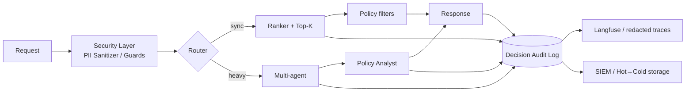

# Model Card & FinOps Report — RetailPartnerX

**Project:** personalized recommendations + shopping assistant  
**Stage:** Prod readiness (educational architecture / governance design)  
**Related modules:** [hw-1 risks](../../hw-1/RetailPartnerX_AI_Strategy.md) · [hw-5 data](../../hw-5/docs/data-pipeline.md) · [hw-6 QA](../../hw-6/docs/quality-assurance.md) · [hw-7 cost](../../hw-7/docs/inference-sizing.md) · [hw-9 high-load](../../hw-9/docs/high-load-architecture.md)

> This is an **educational** Model Card and FinOps scenario, not a real cloud billing report or a production compliance package. The OpEx figures rely on the hw-7 sizing (reference: Aug 2026).

The Model Card structure relies on [Hugging Face Model Cards](https://huggingface.co/docs/hub/model-cards) and the [Mitchell et al., 2018](https://arxiv.org/abs/1810.03993) framework. The FinOps part relies on the [FinOps Framework](https://www.finops.org/framework/) (Inform → Optimize → Operate).

---

## Contents

1. [Part 1. Model Card (Governance)](#sec-1)
2. [Part 2. FinOps Report (+50% over Budget)](#sec-2)
3. [Submission Summary](#sec-3)

---

<a id="sec-1" href="#sec-1"> </a>

## 1. Part 1. Model Card (Governance)

### 1.0. System Metadata (Hub YAML Style)

```yaml
---
system_name: RetailPartnerX-AI-Recsys-Assistant
version: "1.0-mvp-design"
library_name: custom  # Ranker + RAG agents + LLM Client (not a single transformers checkpoint)
pipeline_tag:
  - recommendation
  - conversational
base_model:
  - meta-llama/Meta-Llama-3-70B-Instruct   # self-hosted path (hw-7), INT4 + vLLM
  - proprietary-saas-llm                  # PoC/MVP per ADR-001 (hw-4)
datasets:
  - retailpartnerx/behavioral-events      # App/CDP clicks, carts, purchases (internal)
  - retailpartnerx/pim-catalog            # SKU attributes, allergens, age flags
  - retailpartnerx/policy-kb              # GDPR, 18+, allergen / promo policies
license: other
license_name: internal-retailpartnerx-research
language:
  - ru
  - en
tags:
  - retail
  - recommendations
  - rag
  - multi-agent
  - fairness
  - finops
---
```

**Field explanations (as in the Hub Metadata UI / YAML front matter):**

| Field | Our value | Why it matters on the Hub / in governance |
| ---- | -------------- | --------------------------- |
| `system_name` | `RetailPartnerX-AI-Recsys-Assistant` | Educational analog of a repo/model name; here it is the name of the **system**, not one checkpoint |
| `version` | `1.0-mvp-design` | Card version / design freeze; in prod ↔ `model_uri` / registry (hw-8) |
| `library_name` | `custom` | On the Hub, the inference library (`transformers`, `vllm`…); our stack is not a single HF loader |
| `pipeline_tag` | `recommendation`, `conversational` | Task type for Hub filters/widgets; we have two products in one system |
| `base_model` | Llama-3-70B + SaaS LLM | Base LLM (fine-tune / quant / adapter); dual-path per ADR-001 (hw-4) and sizing (hw-7) |
| `datasets` | behavioral / PIM / policy-kb | Training and context datasets; internal ids, not public Hub datasets |
| `license` / `license_name` | `other` + internal… | License of the weights/artifacts; educational internal, not an open-source SPDX |
| `language` | `ru`, `en` | Languages of the interface and of the catalog/assistant content |
| `tags` | see below | Free-form labels for search and classification on the Hub |

**Tags:**

| Tag | Meaning for RetailPartnerX |
| --- | ------------------------ |
| `retail` | Domain: retail / omnichannel |
| `recommendations` | Ranker → Top-K scenario (± LLM re-rank) |
| `rag` | Policy Analyst / KB on top of retrieval (hw-3) |
| `multi-agent` | Orchestration shopping assistant (hw-3) |
| `fairness` | Bias / fairness slices and metrics (§1.4–1.5) |
| `finops` | The card is linked to the cost envelope and Optimize (§2) |

The card describes the **system** (Ranker + Top-K + optional LLM re-rank + multi-agent assistant), not one weights file: for retail, routing, policy filters and catalog data are critical.

---

### 1.1. Model Details

| Field | Value |
| ---- | -------- |
| **Owner** | RetailPartnerX (AI Architect educational case) |
| **Components** | (1) Collaborative / content Ranker; (2) Top-K candidate stage; (3) LLM re-rank / shopping assistant (Llama-3-70B INT4 or SaaS via LLM Client); (4) Policy Analyst (RAG over the Policy KB) |
| **Inputs** | `customer_id` / session, `sku_id` / query, channel, constraints (budget, allergens) |
| **Outputs** | SKU list + explanation (assistant); structured recommendation payload (OpenAPI hw-2) |
| **Versioning** | `model_uri` / `index_version` from the Model Registry (hw-8); `policy_version` for the Policy KB |

---

### 1.2. Intended Use

**Target scenarios (in scope):**

1. The "Frequently bought together" block / personal recommendations on the SKU page (`POST /get_recommendation`).
2. Shopping assistant in the app: building a cart with budget, promotions, allergens and age restrictions in mind.
3. Semantic guard over internal policies (Policy Analyst) — a **recommendation to refuse/replace**, not legal advice.

**Users:** customers of RetailPartnerX omnichannel channels; pilot operators (human review in the MVP).

**Expected value:** growth in conversion / AOV with controlled latency, cost and compliance (R4, R6, R8 from hw-1).

---

### 1.3. Limitations (Out of Scope)

| Limitation | Why it matters |
| ----------- | ------------ |
| **Not medical or dietary advice** | Allergens and diets rely on PIM attributes + the Policy KB; catalog data errors are possible |
| **Not a replacement for Legal / a GDPR officer** | The assistant gives no legal opinions; personal data minimization is a process + PII Sanitizer (hw-6) |
| **Not for minors without a parental policy** | 18+ SKUs must be filtered out by the Policy Analyst; a filter failure is an R4 incident |
| **Cold start** | New users/SKUs get a popularity / content-based fallback (R2); quality is below personalization |
| **Not an autonomous buyer** | No automatic charges / auto-orders without user confirmation |
| **Quality = data** | With gaps in CDP/PIM (R1), recommendations degrade; a Model Card does not "fix" data quality |
| **Language / region** | Eval and fairness slices currently cover Russian stores and the main FMCG categories; other markets are a separate slice |

**Explicitly prohibited:** using recommender scores as the sole basis for discriminating against employees, price discrimination against protected classes or covert targeting of vulnerable groups without Legal review.

---

### 1.4. Training Data & Bias Analysis

#### 1.4.1. Data Sources

| Dataset | Content | Role | Bias risks |
| ------- | ---------- | ---- | ---------- |
| **Behavioral events** (Kafka ← App/CDP) | view / click / cart / purchase | Ranker training, online features | Skew toward "active" app users; bots; capital regions |
| **PIM catalog** | SKU, categories, price, allergens, 18+ | Content features, RAG Product KB | Incomplete allergens → unsafe suggestions; brand skew of the assortment |
| **Policy KB** | GDPR, 18+, allergens, promotion rules | Policy Analyst | Outdated policy_version → false "ok" |
| **LLM base weights** | Llama-3-70B / SaaS pretrained corpus | Text generation / re-rank | General LLM biases (stereotypes, English-centrism) on top of retail data |

Ranker training is offline on point-in-time joins from the Feature Store (hw-5), with no "peeking" into the future. Product KB embeddings are a batch job after the curated catalog.

#### 1.4.2. Bias Analysis

| Bias hypothesis | How it shows up | Mitigation | Evidence / control |
| ------------- | --------------- | --------- | ------------------- |
| **Popularity bias** | Top SKUs crowd out the long tail and local brands | Diversity re-rank, exploration quota, a separate long-tail exposure metric | Offline: catalog coverage @K; online: share of long-tail impressions |
| **Channel / digital divide** | Users of offline stores only are poorly represented in the CDP | Unified customer ID; popularity fallback by store/region | Share of sessions without digital history; R1 audit |
| **Geographic skew** | Moscow/large cities dominate clicks | Stratified train sample; per-region eval slices | Δ NDCG@K between regions |
| **Category / gender proxy** | Indirect stereotyping of carts (personal care, children's goods, etc.) | No explicit sensitive features; slice metrics; Legal review | Fairness dashboard (below) |
| **Age-restricted leakage** | 18+ in recommendations to minors / without an age gate | Policy Analyst + hard filter before the reply | Zero-tolerance online alert |
| **Allergen under-reporting** | A recommendation despite a stated allergy | Constraint Parser + PIM flags + Policy RAG | Safety eval set; human review of 1–2% (hw-6) |
| **LLM stereotype bleed** | Assistant texts reinforce stereotypes | Output Guardrails; templates; no auto-publishing without validation (R8) | Toxicity / stereotype probes in CI |

**Honest conclusion:** FMCG click data is **not neutral**. The Model Card records this as a managed risk rather than claiming a "model without bias".

---

### 1.5. Fairness Metrics

Classic classification metrics (equalized odds) are adapted to **retail slices** for a multi-class recommender. Target thresholds are design-time; calibration follows MVP measurements.

| Metric | Definition (for RetailPartnerX) | Slices | Target threshold (MVP design) |
| ------- | -------------------------------- | ----- | -------------------------- |
| **Regional parity gap** | \|NDCG@10_region − NDCG@10_global\| | federal districts / store clusters | ≤ 0.05 |
| **Long-tail exposure** | Share of impressions on SKUs outside the top 20% by sales | app / web channel | ≥ 15% while keeping CTR ≥ baseline−10% |
| **Cold-start regret** | Ratio of CTR for new vs returning users | new vs returning | CTR_new ≥ 0.7 × CTR_returning (with popularity fallback) |
| **Age-gate violation rate** | Share of replies with 18+ SKUs without age-ok | assistant + recsys | **0** (release blocker) |
| **Allergen conflict rate** | Recommendations that conflict with a stated constraint | assistant | **0** on the safety eval set; online ≈ 0 + alert |
| **Demographic proxy gap*** | Δ CTR / conversion between segments, where the segment is a *proxy* (not a PII profile) | bucket by store/format, not directly by protected class | monitoring + escalation to Legal on a sustained gap >15% |

\*RetailPartnerX **does not build** fairness on raw protected attributes in Ranker features; we use operational slices and a Legal process (R6).

**Link to the hw-6 eval:** Faithfulness / Answer Relevancy remain for RAG answers; fairness is an orthogonal layer (who gets what utility), not a replacement for quality gates.

---

<a id="sec-1-6" href="#sec-1-6"> </a>

### 1.6. AI Decision Audit Architecture

A course competency: not only the "card", but also **logging decisions** for incident analysis and compliance.



**Minimal audit event schema (no raw personal data):**

| Field | Example | Why |
| ---- | ------ | ----- |
| `request_id`, `ts` | uuid, ISO time | correlation |
| `channel`, `scenario` | `pdp_recsys` / `assistant` | FinOps + fairness slice |
| `model_uri`, `index_version`, `policy_version` | registry ids | reproducibility |
| `candidate_ids` (hashed/sku) | top-K before re-rank | why these products |
| `rank_scores` | float[] | Ranker debugging |
| `llm_used` | bool + model id | cost + right-sizing |
| `policy_verdict` | `ok` / `block` / `substitute` | R4/R8 |
| `guardrail_flags` | injection, pii_masked, toxicity | hw-6 |
| `fairness_slice_ids` | region_bucket, new_user | offline fairness jobs |
| `latency_ms`, `token_in/out`, `cost_est` | numbers | FinOps unit economics |

PII does not reach the traces (PII Sanitizer → redacted Langfuse). TTL and storage classes are in §2.3 (FinOps).

---

### 1.7. Ethical Considerations (Brief)

- Recommendations affect diet, family budget and product availability — **high consumer impact**.
- Allergen / 18+ errors are a safety issue, not "a slightly worse metric".
- Transparency: Model Card + audit log are the minimum for internal review; public consumer-facing disclosure is a Legal/Product decision.
- Human-in-the-loop in the pilot (R4): selective review of the assistant before expanding its autonomy.

---

<a id="sec-2" href="#sec-2"> </a>

## 2. Part 2. FinOps Report (+50% over Budget)

### 2.0. Budget Context (Educational Scenario)

Based on hw-7: the target GPU setup is **2×A100 INT4 + vLLM ≈ 464k ₽/month** (Yandex / Cloud.ru). The Prod envelope also includes CPU/API, Object Storage, logs/traces, Vector DB and staging.

| Item (plan) | Budget, ₽/month | Comment |
| ------------- | ------------: | ----------- |
| GPU inference (prod, 2×A100) | 464 000 | hw-7 scenario C |
| GPU / VM non-prod (staging, experiments) | 80 000 | off-hours schedule was expected |
| Object Storage + Feature/Lake | 40 000 | S3 raw/curated |
| Observability (logs, traces, Langfuse volume) | 35 000 | sampling 1–2% |
| Vector DB + Redis + other | 31 000 | ANN + cache |
| **Total budget** | **650 000** | approved FinOps envelope |

**Actual for the month:** a bill of **975 000 ₽** → **+50%** over budget (**+325 000 ₽**).

FinOps phases ([Framework](https://www.finops.org/framework/)): first **Inform** (bill analysis), then **Optimize** (technical plan), then **Operate** (alerts, ownership, unit economics).

---

<a id="sec-2-1" href="#sec-2-1"> </a>

### 2.1. Inform — Analyzing the Overrun

| Item | Plan | Actual | Δ | Typical cause |
| ------ | ---: | ---: | -: | ---------------- |
| GPU prod | 464k | 520k | +56k | LLM RPS growth: Ranker requests went to 70B; weak Semantic Cache hit rate |
| GPU non-prod | 80k | 210k | **+130k** | **forgotten GPU instances** (overnight fine-tune / demo nodes running 24×7) |
| Storage + logs | 75k | 165k | **+90k** | **inefficient log storage**: full prompt/completion DEBUG without TTL, hot storage |
| Vector / Redis / misc | 31k | 80k | +49k | bloated indexes, several copies of the Product KB |
| **Total** | **650k** | **975k** | **+325k** | |

---

### 2.2. Typical Root Causes

#### A. Forgotten GPU Instances (≈ 40% of the Overrun)

- Staging and a "one-off" fine-tune cluster were left on-demand for the whole month.
- No auto-shutdown / TTL on the `experiments` namespace.
- No FinOps `owner` / `ttl_date` tags → nobody receives an anomaly alert.

#### B. Inefficient Log Storage (≈ 28% of the Overrun)

- Langfuse / Tempo / object logs wrote **full** prompts for 100% of traffic instead of a 1–2% sample (hw-6 design).
- 90+ day retention in the hot tier; no move to Glacier/Cold.
- Duplicates: app logs + LLM traces + audit with the same payload.

#### C. Too "Smart" a Model for Simple Tasks (≈ 17% of the Overrun + Part of Prod GPU)

- The sync path `/get_recommendation` often called Llama-3-70B re-rank where Ranker + Top-K is enough (an anti-pattern against the hw-2 latency budget and hw-9 high-load design).
- No cost-aware routing: `llm_used=true` by default for "quality just in case".

#### D. Secondary Effects (≈ 15%)

- Several versions of the Vector DB index without GC.
- No Spot for batch embedding / offline eval.
- Egress growth from exporting traces.

---

<a id="sec-2-3" href="#sec-2-3"> </a>

### 2.3. Optimize — Cost Optimization Plan

Specific **technical** measures (not "ask the cloud for a discount"). Savings are order-of-magnitude estimates against the current actual of 975k → target corridor **≈ 550–620k ₽/month** while keeping SLOs.

| # | Measure | What to do in the architecture | Expected effect | Quality/risk trade-off |
| - | ---- | ------------------------- | ---------------- | ----------------------- |
| 1 | **Spot / preemptible GPU** | Batch: embeddings, offline eval, distillation training on Spot; prod sync inference stays on-demand (or Spot+fallback pool) | −40–70% on non-prod/batch GPU → around **−80…120k ₽** | Job interruptions; requires checkpoint + retry |
| 2 | **Model Distillation** | Teacher 70B → Student 7–8B (or ranker-only) for: (a) simple re-rank, (b) Intent Parser; 70B only for complex assistant turns | −30–50% LLM GPU/token on "simple" turns → **−50…90k ₽** | Requires regression eval (Faithfulness, NDCG); hw-8 Canary |
| 3 | **Data TTL and lifecycle** | Audit/traces: hot 7d → warm 30d → delete/cold 90d; raw lake: lifecycle rules; Semantic Cache TTL as in hw-9; no DEBUG prompts in prod | **−70…100k ₽** on storage/observability | Shorter forensic window; critical incidents get a separate legal hold |
| 4 | **Cost-aware routing** | Policy: sync recsys → Ranker/Top-K; LLM re-rank only if `confidence < τ` or a VIP segment; assistant — small→large cascade | **−40…70k ₽** prod GPU | Rare edge case without LLM re-rank; monitor CTR/NDCG |
| 5 | **Semantic Cache + KEDA (already in hw-9)** | Raise the hit rate by tuning θ; scale-to-zero async workers | reduces LLM RPS | Stale cache → strict invalidation by `index_version` |
| 6 | **Right-size non-prod** | Schedule: GPU staging 09–21; idle shutdown after 1h; namespace quotas | **−100…130k ₽** vs "forgotten" GPUs | Less convenient for overnight experiments → job queue |
| 7 | **INT4 + vLLM discipline** | Do not fall back to FP16 "for quality" in prod without an ADR | keeps the hw-7 baseline | Eval gate on quality drop |

**In total (conservatively):** back within the **650k** budget corridor with a **≈ 5–15%** margin after 1–2 Optimize sprints.

```text
Actual 975k
  − Spot/batch & non-prod hygiene   ≈ 120k
  − TTL / log lifecycle             ≈  90k
  − Distillation + routing          ≈ 100k
  − Cache / index GC                ≈  40k
────────────────────────────────────────
Target ≈ 625k  (within the 650k budget)
```

---

### 2.4. Operate — Ownership, Alerts, Unit Economics

| FinOps practice | Adoption at RetailPartnerX |
| --------------- | -------------------------- |
| **Everyone takes ownership** | Tags: `team`, `env`, `ttl_date` on every GPU/node pool |
| **Timely data** | Daily cost report + anomaly (>120% of the daily run rate) |
| **Unit economics** | Grafana/Langfuse: ₽ / recommendation, ₽ / assistant turn, tokens / turn (hw-6 widgets) |
| **Central enablement** | FinOps + Platform set quotas; Product approves the quality floor |
| **Variable cost model** | Spot for batch; scale-to-zero for async workers (KEDA) |

**Action plan (2 weeks):**

| Day | Action | Owner |
| ---- | -------- | ----- |
| 0–1 | Shut down/tag orphan GPUs; inventory with `ttl_date` | Platform |
| 1–3 | Lifecycle TTL on logs/traces; sampling 1–2% | Platform + MLOps |
| 3–7 | Routing policy: LLM off by default on the sync path | ML Architect |
| 5–10 | Start the distillation PoC + eval gate | ML + QA |
| 7–14 | Spot queues for embedding/eval; cost dashboards + alerts | Platform + FinOps |

---

<a id="sec-2-5" href="#sec-2-5"> </a>

### 2.5. Maturity: The Cost ↔ Quality Balance

| Decision | When we save | When we do **not** save |
| ------- | -------------- | --------------------- |
| Distillation / smaller model | Intent parsing, simple re-rank, FAQ-like turns | Complex multi-constraint assistant, quality incidents |
| Spot GPU | Embeddings, training, overnight eval | The only sync inference replica without a fallback |
| Less LLM on the sync path | High Ranker confidence, cache hit | NDCG/CTR drop in a Canary, complaints about "dumb" recommendations |
| Short log TTL | DEBUG/prompts | Legal hold, security incident, fairness investigation window |
| Cutting Policy / Guardrails | **Never** for the sake of costs | — |

**Principle:** FinOps maximizes **business value** rather than minimizing the bill at any price ([FinOps principles](https://www.finops.org/framework/)). For RetailPartnerX, the quality floor = 0 age-gate violations + allergen safety + NDCG/CTR within the Canary rollback limits (hw-8). Anything above the floor that burns GPU "just in case" is a candidate for Optimize.

---

<a id="sec-3" href="#sec-3"> </a>

## 3. Submission Summary

| Course criterion | Where it is met |
| -------------- | ----------- |
| Ethics: Model Card, bias risks | §1.2–1.5, §1.7 |
| Economics: specific technical measures | §2.3 (Spot, Distillation, TTL, routing, cache) |
| Maturity: cost ↔ quality | §2.5 |
| Audit logging of decisions | §1.6 |

> **Abbreviations:** [Glossary](../Glossary.md)
