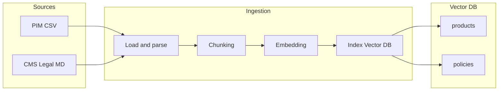
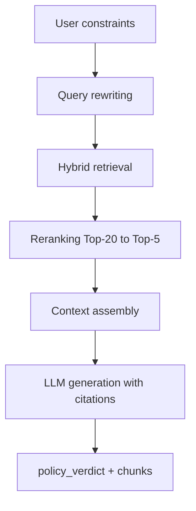

# Step 3: RAG Flow

Case: RetailPartnerX · agents: [agents.md](agents.md) · Vector DB from [hw-2](../../hw-2/diagrams/README.md)

## 3.1 Knowledge Sources

| Corpus | Content | Storage | Consumer |
|--------|------------|----------|-------------|
| **Product KB** | SKU name, ingredients, category, attributes | Vector DB, `products` collection | Catalog Searcher |
| **Policy KB** | Allergens, promotion rules, GDPR texts, "what must not be recommended" guideline | Vector DB, `policies` collection | Policy Analyst; Promo Analyst (RAG fragments — v2) |

The Policy KB covers risks **R4, R6, R8** from [hw-1](../../hw-1/RetailPartnerX_AI_Strategy.md).

In the MVP, the **Promo Analyst** reads prices and promotions from the SQL DB; RAG fragments from `policies` (for example, promotion rules) are an optional v2.

## 3.2 Ingestion pipeline (offline)



### Loading

- **Products:** PIM export → CSV/JSON (`sku_id`, `title`, `description`, `ingredients`, `category`, `allergens[]`).
- **Policies:** Markdown/PDF from CMS/Legal (`policy_id`, `doc_type`, `jurisdiction`, `effective_date`, `body`).

### Chunking

| Corpus | Strategy | Size | Overlap | Metadata |
|--------|-----------|--------|---------|------------|
| **Policies** | By section headings (`##`) | 300–500 tokens | 50–80 tokens | `doc_type`, `jurisdiction`, `effective_date`, `policy_id` |
| **Products** | 1 SKU = 1 document | "name + ingredients + category" (~100–200 tokens) | 0 | `sku_id`, `category`, `allergens[]` |

Tools: `RecursiveCharacterTextSplitter` (LangChain) for policies; a fixed template for SKUs.

### Embedding

- Model: `multilingual-e5-base` or `text-embedding-3-small` (Russian language support).
- **Separate collections** `products` and `policies` — different term density and different reranking thresholds.
- Vector normalization (cosine similarity).

### Indexing

- **Vector DB:** pgvector / Qdrant / Pinecone.
- Indexes: HNSW for `products` (high QPS), IVF for `policies` (smaller volume, higher accuracy).
- Index versioning: `index_version` in the metadata for rollback.

### Optional: Knowledge Graph

Nodes and edges for pre-filtering before vector search:

- `SKU --has_allergen--> gluten`
- `Promo --applies_to--> Category`
- `Policy --governs--> Category`

The graph lives in Neo4j or a property graph in PostgreSQL; the Policy Analyst first filters by the graph, then runs dense retrieval.

## 3.3 Query pipeline (online, Policy Analyst)



### 1. Query rewriting

The Orchestrator passes a structured query:

```text
constraints: gluten-free; category: pasta; context: dinner for 4 people
```

### 2. Hybrid retrieval

| Method | Purpose | Top-N |
|-------|------------|-------|
| **Dense** (vector) | Semantics of "gluten-free alternatives" | 20 |
| **Sparse** (BM25) | Exact legal wording ("gluten", "allergen") | 20 |
| **Fusion** (RRF) | Merging the lists | 20 |

Metadata filters: `doc_type=policy_allergen`, `effective_date <= today`.

### 3. Reranking

- Cross-encoder: `BAAI/bge-reranker-v2-m3` (multilingual).
- Top-20 → Top-5 chunks; threshold `score < 0.35` → fallback "please check with a consultant" (R8).

### 4. Context assembly

The Prompt Template Factory (name from hw-2 C3) assembles:

```text
[POLICY_CHUNKS]
- {policy_id}: {chunk_text}
...
[CONSTRAINTS]
{dietary_constraints}
[QUESTION]
May the following product categories be recommended?
```

### 5. Generation + citation

- The LLM returns `verdict: allow | deny | clarify` + `cited_policy_ids[]`.
- Chunks and the verdict are logged for GDPR audit (hw-1, R6).

## 3.4 Catalog Searcher RAG (Product KB)

A simplified online pipeline for products:

1. Query = "gluten-free pasta" + filter `category IN (...)` from the Intent Parser.
2. Vector search in `products`, Top-10.
3. SQL post-filter: `price <= budget`, `in_stock = true`.
4. No reranking in the MVP prototype; in Production, the same cross-encoder.

## 3.5 NFR

| Requirement | Solution |
|------------|---------|
| Chat latency | Asynchronous mode: multi-step loop of 5–15 s (unlike the synchronous product page block in hw-2) |
| Audit | Log of `retrieval_chunks[]`, `policy_verdict`, `index_version` |
| Policy drift | Scheduled re-ingestion on CMS updates; alert on `effective_date` change |

## 3.6 Link to the Architecture

On the [multi-agent-architecture](../diagrams/multi-agent-architecture.drawio) diagram:

`Policy KB (CMS/Legal)` → offline ingestion → `Vector DB / policies` → **Policy Analyst** → Orchestrator.
