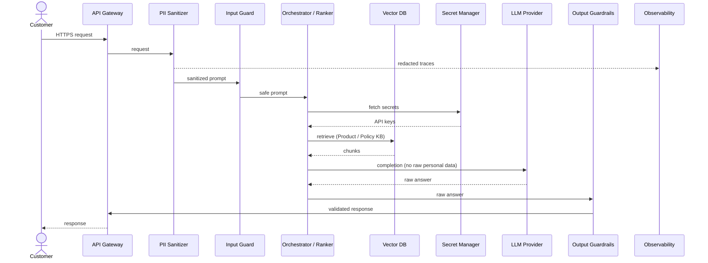
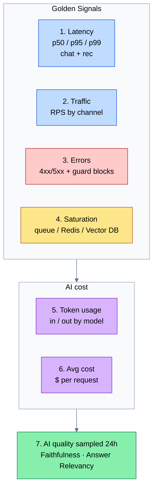

# Quality Assurance — RetailPartnerX

**Project:** personalized recommendations + shopping assistant  
**Stage:** MVP → Prod readiness  
**Security diagram:** [diagrams/security-layer.drawio](../diagrams/security-layer.drawio) · [PNG](../diagrams/security-layer.png)

Link to previous assignments: risks **R4 / R6 / R8** ([hw-1](../../hw-1/RetailPartnerX_AI_Strategy.md)); AI Service / `POST /get_recommendation` ([hw-2](../../hw-2/diagrams/README.md)); agents + Policy Analyst / Guardrails ([hw-3](../../hw-3/docs/agents.md)); LLM hosting ([hw-4](../../hw-4/README.md)); Product KB freshness ([hw-5](../../hw-5/docs/data-pipeline.md)).

## 1. Security Layer

Goal: strengthen the chat and recommendation path with a **PII Sanitizer**, **Input Guard** (Prompt Injection), **Output Guardrails** and **Secret Manager** — before a reply reaches the user or a prompt goes to an external LLM.

### Components on the Diagram

| Component | Where in the flow | What it does | Risks / OWASP |
| --------- | ------------ | ---------- | ------------- |
| **API Gateway** | Entry | AuthN, rate limit, TLS | Abuse / DoS |
| **PII Sanitizer** | Before the LLM | Masks `customer_id`, full name, phone, address, email in prompts and traces | **R6**, LLM02 Sensitive Information Disclosure |
| **Input Guard** | After sanitize | Detects / blocks Prompt Injection, jailbreaks, "ignore the policy" attempts | **LLM01 Prompt Injection** |
| **Orchestrator + agents** | Core (hw-3) / Ranker (hw-2) | Business logic; secrets only via the Secret Manager | — |
| **Output Guardrails** | After the LLM | Citations to RAG chunks, blocklist (18+, toxicity), refusal on a low score | **R4, R8**, LLM05 Improper Output Handling |
| **Secret Manager** | Outside the code | LLM / Vector DB API keys; rotation | LLM10 Model Theft / credential leak |
| **Observability (redacted)** | In parallel | Traces without raw personal data (Langfuse + Prometheus) | R6 |

### Sequence (Happy Path)

The component diagram is in [security-layer.png](../diagrams/security-layer.png). Below is the call order for a single chat / recommendation request.

The Policy Analyst (hw-3) remains a semantic guard over the Policy KB; **Output Guardrails** are a technical reply validator (schema, blocklist, grounding check) at the service boundary.

## 2. Testing Strategy (RAG quality)

We evaluate the quality of the **shopping assistant** (Policy KB + Product KB) and, separately, the relevance of Ranker replies where genAI explanations exist. To compare LLMs (SaaS vs self-host from hw-4), we fix one gold set of scenarios.

### RAG Metrics

| Metric | What it measures | Why RetailPartnerX needs it |
| ------- | ------------ | -------------------- |
| **Faithfulness** | The reply relies on retrieved chunks, with no invented facts | Anti-hallucination for SKUs, allergens, promotions (**R8**) |
| **Answer Relevancy** | The reply matches the user's question | "Build a gluten-free dinner…" does not drift to irrelevant SKUs |
| **Context Precision** (extra) | Little "noise" in the Top-K | Product/Policy retrieval quality after the hw-5 embedding pipeline |
| **Context Recall** (extra) | The needed facts made it into the context | Allergens / policies are not "lost" |

Infrastructure metrics (CPU, RAM) **do not replace** these quality evaluations.

### Tooling

**Ragas** (primary) + optionally **DeepEval** for CI gates:

| Layer | Tool | How we use it |
| ---- | ---------- | -------------- |
| Offline eval / LLM comparison | **Ragas** | A dataset of 30–50 dialogs (happy path + adversarial: injection, allergens); the metrics above; A/B of two LLMs |
| CI / regression | **DeepEval** (or Ragas in pytest) | Thresholds Faithfulness ≥ 0.85, Answer Relevancy ≥ 0.8 on a smoke set before agent releases |
| Online (prod) | Sample + human review | 1–2% of traces in Langfuse → labeling; alert when rolling Faithfulness drops |

**Gold scenarios (minimum):** a budget gluten-free dinner; refusal without `personalization_consent` (R6); the Prompt Injection "ignore allergens"; a SKU with an expired promotion (link to hw-5 freshness).

## 3. Observability (Grafana dashboard)

Stack: **Prometheus** (metrics) + **Tempo**/OTel (traces) + **Langfuse** (LLM traces, cost) → widgets in **Grafana**.

### Widgets of the "AI Service — RetailPartnerX" Dashboard

| # | Widget | Source | SLO / why |
| - | ------ | -------- | ----------- |
| 1 | **Latency** — p50 / p95 / p99 `POST /get_recommendation` and chat turn | Prometheus / Tempo | Latency NFR; Ranker / LLM degradation |
| 2 | **Traffic** — RPS by endpoint / channel (product page vs chat) | Prometheus | Load, capacity |
| 3 | **Errors** — 4xx/5xx, share blocked by Input Guard / Output Guardrails | Prometheus | Incidents, guard false positives |
| 4 | **Saturation** — Orchestrator queue depth, Redis / Vector DB util | Prometheus | Bottlenecks before OOM / timeouts |
| 5 | **Token usage** — tokens in/out per request, by model | Langfuse → Prometheus | Cost and provider limits |
| 6 | **Avg cost per request** — $ / turn (LLM + embedding batch amort.) | Langfuse | Unit economics MVP→Prod |
| 7 | **AI quality (sampled)** — rolling Faithfulness / Answer Relevancy | Eval job → Prometheus | Not CPU: quality of model replies |

### Layout Mockup (Grafana)

| Row | Meaning |
| --- | ----- |
| 1–4 | Golden Signals (SRE) |
| 5–6 | Cost / tokens (Langfuse) |
| 7 | Quality of model replies (not CPU) |

Alerts (minimum): p95 latency > SLA; error rate > 2%; cost/request spike ×2; Faithfulness below the threshold for 2 hours in a row.

> **Abbreviations:** [Glossary](../Glossary.md)
