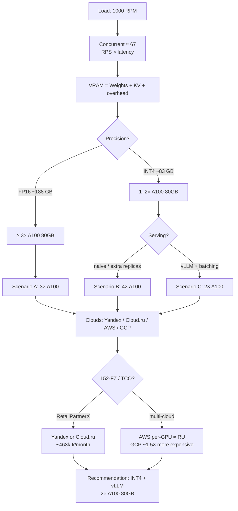

# Inference sizing — Llama-3-70B @ 1000 RPM

> **RetailPartnerX** · educational capacity / cost estimate for a self-hosted shopping assistant  
> Short conclusion: [recommendation.md](recommendation.md) · ADR: [hw-4](../../hw-4/docs/adr-001-llm-hosting.md)

## TL;DR — Recommendation

| | |
| --- | --- |
| **Stack** | Llama-3-70B **INT4** (AWQ/GPTQ) + **vLLM** |
| **Hardware** | **2× NVIDIA A100 80GB** |
| **Cloud** | **Yandex Cloud** or **Cloud.ru** (~463–464k ₽/month GPU) |
| **Why not GCP** | A100 80GB is ~**1.5×** more expensive (~704k ₽ for 2×) |
| **Why not plain AWS** | The per-GPU price is close, but A100 often comes only as an **8× bundle** (~1.9M ₽) |
| **Do not use** | **T4** for 70B @ 1000 RPM; FP16 — only for eval |

## Decision Map

The sizing chain (figures are in the tables below):



---

## Contents

1. [Assumptions](#1-assumptions)
2. [VRAM](#2-vram--weights--kv-cache--overhead)
3. [GPU Selection](#3-gpu-selection)
4. [Cost Scenarios](#4-cost-scenarios)
5. [Clouds: Pricing](#5-clouds-pricing)
6. [Scenario Cost](#6-scenario-cost--month)
7. [Optimizations](#7-optimizations-batching--vllm)
8. [Sources](#8-sources)

Prices are a reference for **Aug 2026**, on-demand, **GPU only** (no disks/egress). FX: **1 USD = 95 ₽**. A month = **730** h.

---

## 1. Assumptions

| Parameter | Value | Why |
| -------- | -------- | ----- |
| Model | Meta Llama-3-70B Instruct | Self-hosted from the ADR-001 roadmap |
| Load | **1000 RPM** ≈ **16.7 RPS** | The assignment |
| `seq_len` | **2048** tokens | prompt + RAG + answer |
| p95 latency | **~4 s** | hw-2 NFR class |
| Concurrent | **≈ 67** | Little: `RPS × latency` |
| Overhead | **5 GB** / replica | CUDA / activations |

**KV Cache (GQA):** `n_layers=80`, `n_kv_heads=8`, `head_dim=128`  
→ `2 × 80 × 8 × 128 × 2 B = 327 680 B` ≈ **0.3125 MB / token**

---

## 2. VRAM = Weights + KV Cache + overhead

```text
Weights_GB = N_params × bytes_per_param / 1e9
KV_GB      = (0.3125 / 1024) × seq_len × concurrent
VRAM_GB    = Weights_GB + KV_GB + Overhead_GB
```

### Weights

| Precision | Bytes / param | Weights |
| --------- | ------------ | ------- |
| **FP16** | 2 | **140.0 GB** |
| **INT4** | 0.5 | **35.0 GB** |

### KV at seq_len=2048, concurrent=67

| Metric | Calculation | Result |
| ------- | ------ | ---- |
| Per request | 2048 × 0.3125 MB | **0.64 GB** |
| For 67 concurrent | 67 × 0.64 | **≈ 42.9 GB** |

### Total

| Mode | Weights | KV | Overhead | **Σ VRAM** |
| ----- | -------: | --: | --------: | ---------: |
| FP16 | 140.0 | 42.9 | 5.0 | **≈ 187.9 GB** |
| INT4 | 35.0 | 42.9 | 5.0 | **≈ 82.9 GB** |

> **INT4** cuts the weights by **4×**, but KV stays large at high concurrency. PagedAttention / KV FP8 give extra headroom (see §7).

---

## 3. GPU Selection

| GPU | VRAM | Role |
| --- | ---- | ---- |
| A100 80GB | 80 GB | main candidate |
| A100 40GB | 40 GB | INT4 + multi-GPU |
| L4 | 24 GB | INT4, TP ≥ 2 |
| T4 | 16 GB | not for 70B @ 1000 RPM |

### FP16 (≈ 188 GB Needed)

| Config | Σ VRAM | Status | Comment |
| ------ | -----: | ------ | ----------- |
| 2× A100 80GB | 160 GB | ❌ no | ~28 GB short for KV |
| **3× A100 80GB** | 240 GB | ✅ OK | **baseline FP16** |
| 4× A100 40GB | 160 GB | ❌ / very tight | same as 2×80 |
| L4 / T4 | — | ❌ | too many cards |

### INT4 (≈ 83 GB Needed)

| Config | Σ VRAM | Status | Comment |
| ------ | -----: | ------ | ----------- |
| 1× A100 80GB | 80 GB | ⚠️ very tight | OK at concurrent ~55 or with KV FP8 |
| **2× A100 80GB** | 160 GB | ✅ **recommended** | headroom for batching |
| 2× L4 | 48 GB | ❌ | 35 + 43 > 48 |
| 4× L4 | 96 GB | ✅ alternative | lower memory BW |
| 6× T4 | 96 GB | ❌ not recommended | weak throughput |

**Conclusion:** FP16 → at least **3× A100 80GB**. INT4 → **2× A100 80GB** for prod @ 1000 RPM.

> VRAM is necessary but not sufficient: at ~200 output tok/req, the reference is **~3300 tok/s** per cluster. With vLLM INT4 on 1–2×A100, typically **~800–1500 tok/s** → 1000 RPM often needs 2–4 effective "slots", not one tightly packed card.

---

## 4. Cost Scenarios

| ID | Scenario | GPU | Purpose |
| -- | -------- | --- | ---------- |
| **A** | FP16 baseline | **3× A100 80GB** | memory without strong batching |
| **B** | INT4 conservative | **4× A100** (2 shards × 2) | extra throughput safety |
| **C** | INT4 + vLLM | **2× A100 80GB** | **target** |
| **D** | INT4 on L4 | **8× L4** | without A100 |

---

## 5. Clouds: Pricing

### Summary — 1× A100 80GB / Month

| Cloud | ≈ ₽ / GPU·month | Relative to RU |
| ------ | ------------: | --------------- |
| Cloud.ru | **~232k** | baseline |
| Yandex Cloud | **~232k** | parity |
| AWS (p4de share ÷ 8) | **~238k** | ≈ the same |
| **GCP** (`a2-ultragpu-1g`) | **~352k** | **+~50%** |

### Yandex Cloud

Source: [Compute pricing](https://yandex.cloud/en/docs/compute/pricing)

| GPU | $/hour | ≈ ₽/hour | ≈ ₽/month |
| --- | ----: | ------: | ------: |
| A100 | **3.345** | 318 | **232 000** |
| T4 | **0.576** | 55 | **40 000** |
| L4 | — | — | not in the same table |

### Cloud.ru (Evolution, Including VAT)

Source: [GPU products](https://cloud.ru/products/vychislitelnyye-moschnosti-s-gpu)

| Config | ₽/hour | ≈ ₽/month |
| ------ | ----: | ------: |
| 1× A100 80GB | **317.20** | **231 600** |
| 2× A100 80GB | **634.40** | **463 100** |
| 1× A100 40GB | **256.20** | **187 000** |
| L4 (estimate) | **~220** | **~160 600** |

### AWS (us-east-1)

Source: [EC2 on-demand](https://aws.amazon.com/ec2/pricing/on-demand/)

| GPU | Reference | ≈ ₽/month per GPU |
| --- | -------- | ---------------: |
| A100 80GB | $27.45 ÷ 8 (`p4de`) ≈ **$3.43**/GPU·h | **~238 000** |
| A100 40GB | $21.96 ÷ 8 (`p4d`) ≈ **$2.75** | **~191 000** |
| L4 | `g6.xlarge` **$0.80–0.98** | **~55–68k** |
| T4 | `g4dn.xlarge` **~$0.53** | **~37 000** |

> **Caveat:** A100 on AWS usually comes as an **8-GPU bundle**. For "exactly 2×A100" — an underused node or another SKU (L4, etc.).

### Google Cloud

Source: [Accelerator-optimized](https://cloud.google.com/products/compute/pricing/accelerator-optimized)

| GPU / VM | $/hour | ≈ ₽/month |
| -------- | ----: | ------: |
| A100 80GB `a2-ultragpu-1g` | **~5.07** | **~352 000** |
| A100 40GB `a2-highgpu-1g` | **~3.67** | **~255 000** |
| L4 `g2-standard-4` | **~0.70** | **~49 000** |

On GCP it is convenient to take **1× A100** without an 8-GPU SKU, but it is **more expensive** than RU / AWS per-GPU.

---

## 6. Scenario Cost / Month

| Scenario | GPUs | Yandex | Cloud.ru | AWS* | GCP |
| -------- | ---: | -----: | -------: | ---: | --: |
| A · FP16 | 3× A100 | **696k** | **695k** | **714k** | **1 056k** |
| B · INT4 conservative | 4× A100 | **928k** | **926k** | **952k** | **1 408k** |
| **C · INT4 + vLLM** | **2× A100** | **464k** | **463k** | **476k** | **704k** |
| D · INT4 L4 | 8× L4 | n/a | **~1 285k** est. | **~440–544k** | **~392k** |

\*AWS is the *effective* GPU share. The real minimum is **8× A100** (p4de), so C ≈ **~1.9M ₽/month**.

**Choice for RetailPartnerX:** Yandex ≈ Cloud.ru on price; plus **152-FZ / data residency**. AWS/GCP — if multi-cloud and there is no residency requirement.

---

## 7. Optimizations (Batching / vLLM)

| Technique | Effect | Estimate |
| ------- | ------ | ------ |
| **INT4** (AWQ/GPTQ) | weights 140 → 35 GB | move from 3×A100 FP16 to 2×A100 |
| **Continuous batching** | higher GPU util | **+1.5–3×** throughput |
| **vLLM PagedAttention** | less KV fragmentation | **+20–40%** concurrent |
| **KV FP8** (optional) | KV ÷ ~2 | another **+10–20%** headroom |

| Path | GPU | ₽/month (Cloud.ru) | vs A |
| ---- | --- | ---------------: | ---- |
| A · FP16 | 3× A100 | ~695k | 100% |
| **C · INT4 + vLLM** | **2× A100** | **~463k** | **≈ −33%** |
| B · INT4 without vLLM | 4× A100 | ~926k | worse |

**Projected savings:** C vs A → **~30–40% OpEx**; C vs B → up to **~50%**.

---

## 8. Sources

| Topic | Link |
| ---- | ------ |
| VRAM calculator | [HF Space](https://huggingface.co/spaces/NyxKrage/LLM-Model-VRAM-Calculator) |
| Llama 3.1 memory | [HF blog](https://huggingface.co/blog/llama31) |
| Yandex | [Compute pricing](https://yandex.cloud/en/docs/compute/pricing) |
| Cloud.ru | [GPU](https://cloud.ru/products/vychislitelnyye-moschnosti-s-gpu) |
| AWS | [EC2 on-demand](https://aws.amazon.com/ec2/pricing/on-demand/) |
| GCP | [Accelerator pricing](https://cloud.google.com/products/compute/pricing/accelerator-optimized) |

---

## Bottom Line

Self-hosted **Llama-3-70B INT4 + vLLM** on **2× A100 80GB** in **Yandex Cloud / Cloud.ru** (~**0.46M ₽/month** GPU) is a working TCO anchor for revisiting ADR-001 as load grows to 1000 RPM.

Duplicate one-pager: [recommendation.md](recommendation.md).
