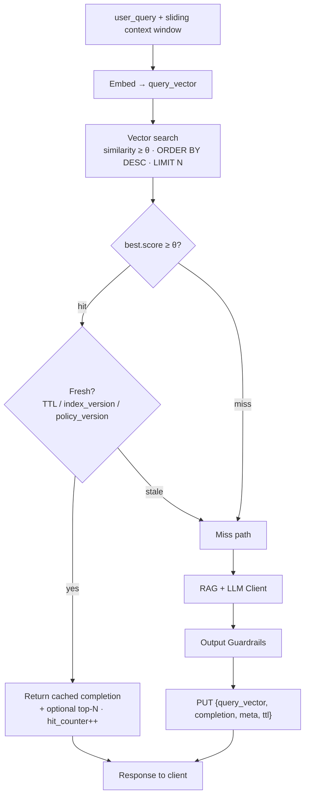
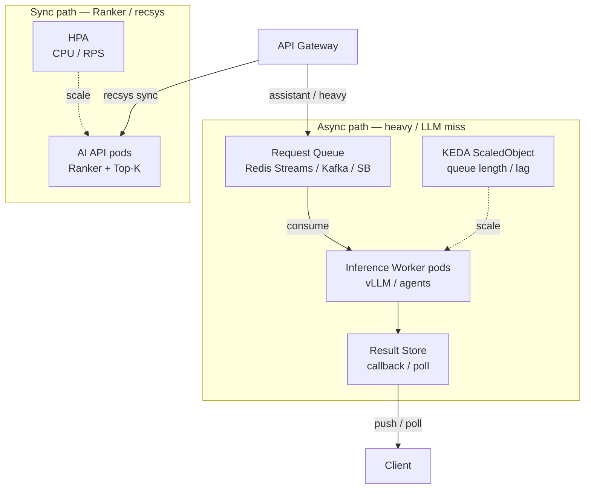
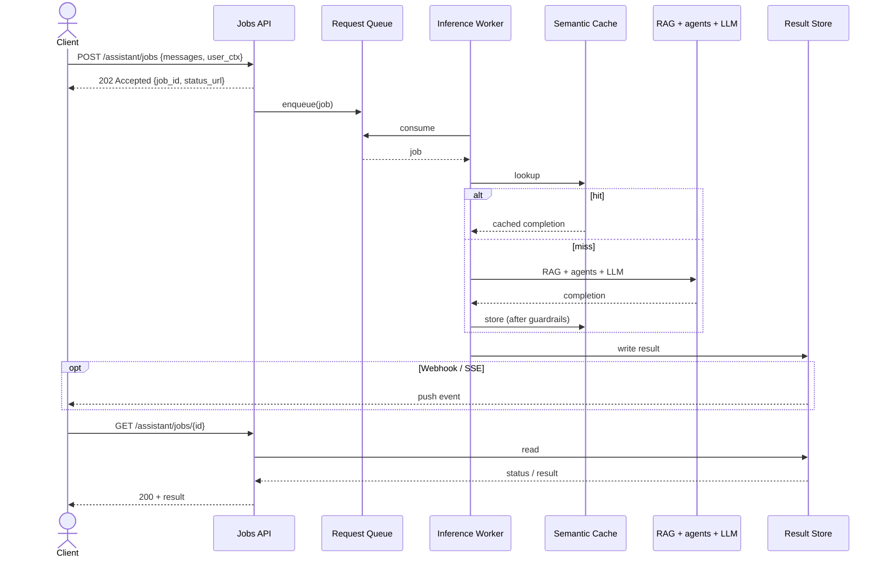
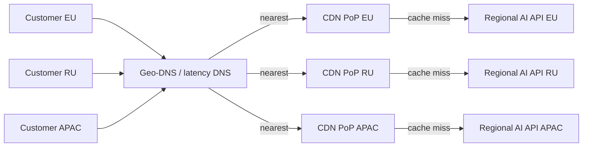
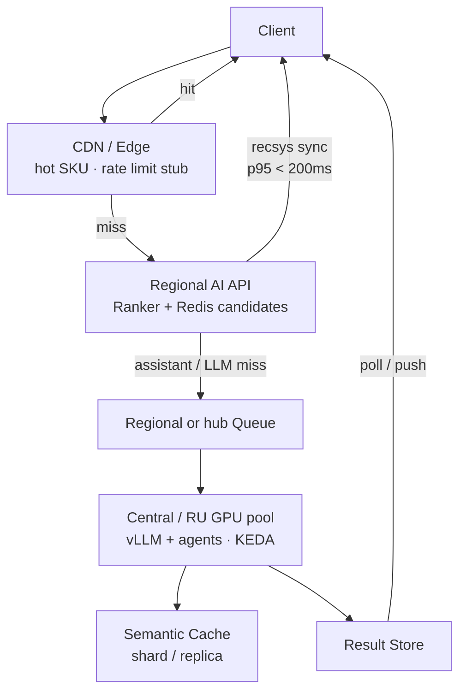
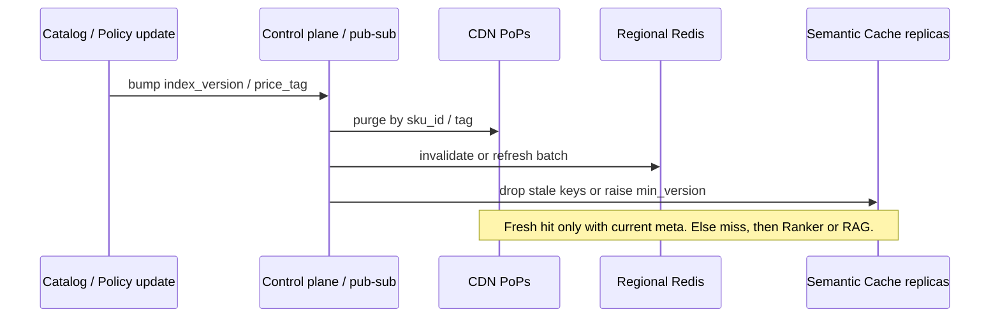
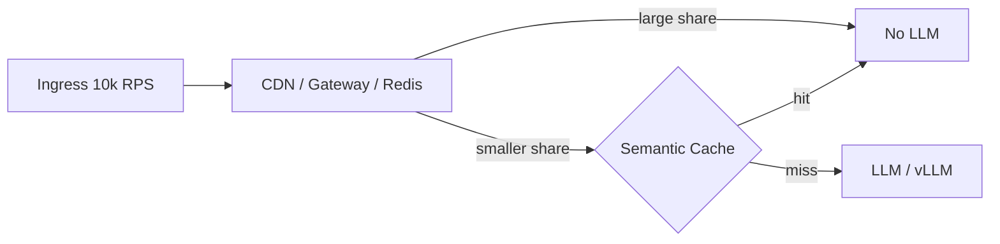

# High-Load Architecture — RetailPartnerX

**Project:** personalized recommendations + shopping assistant  
**Stage:** Prod scale-out (educational architecture design)  
**Target NFRs:** **10 000 RPS**, **p95 latency &lt; 200 ms** on the synchronous path  
**Diagram:** [diagrams/high-load-architecture.drawio](../diagrams/high-load-architecture.drawio) · [PNG](../diagrams/high-load-architecture.png)

Link to previous assignments: latency budget A-001 and Redis candidates ([hw-2](../../hw-2/diagrams/README.md)); multi-agent assistant ([hw-3](../../hw-3/docs/agents.md)); LLM Client ([hw-4](../../hw-4/docs/adr-001-llm-hosting.md)); embeddings / Vector DB ([hw-5](../../hw-5/docs/data-pipeline.md)); metrics ([hw-6](../../hw-6/docs/quality-assurance.md)); GPU sizing ([hw-7](../../hw-7/docs/recommendation.md)); K8s/GitOps ([hw-8](../../hw-8/docs/delivery-pipeline.md)).

> This is an **educational** high-load design, not a production deployment or a measurement of real 10k RPS. The goal is to show *how* to hold latency as load grows through caching, inference scaling and async.

---

## 0. Path Separation (Key Assumption)

| Path | API / scenario | RPS share (estimate) | Latency SLO | Processing model |
| ---- | -------------- | ----------------- | ----------- | ---------------- |
| **Sync hot path** | `POST /get_recommendation` (SKU page) | ~85–95% of traffic | **p95 &lt; 200 ms** | Synchronous; cache + Ranker; LLM rarely |
| **Async heavy path** | Shopping assistant (multi-agent, long RAG) | ~5–15% | Accept + poll / push; completion in seconds is OK | Queue → workers → callback |

**Why 10k RPS ≠ 10k LLM calls:** without a cache and Top-K, even 2×A100 (hw-7 @ 1000 RPM ≈ 17 LLM RPS) physically cannot cope. The high-load strategy = **cut out the LLM** on most requests and send the remaining LLM traffic through a queue and KEDA.

---

## 1. Caching Strategy

A multi-level cache: each layer cuts the RPS reaching the next one.

### 1.1. Where We Cache

| Layer | What it stores | Hit → effect | TTL / invalidation |
| ---- | ---------- | ------------ | ----------------- |
| **CDN (Edge)** | Frontend static content; optionally anonymous/popular "Frequently bought together" blocks (short TTL) | Takes RPS off the origin | TTL 30–120 s; purge by `sku_id` on catalog changes |
| **API Gateway** | Idempotent responses by key `(sku_id, segment, channel)` for recsys | Less load on the AI Service | TTL 15–60 s; do not cache PII/a personal deep profile without a segment |
| **Redis — candidates / features** (hw-2) | Precomputed Ranker candidates, hot features | Sync path without SQL/Feature Store on every hit | Batch refresh from the Feature Store (hw-5); TTL + version key |
| **Semantic Cache** (Redis + vector index / Cosmos-style) | Embedding(query + context) → LLM completion | Skips the LLM on similar intent | Similarity threshold + TTL; see the algorithm below |

The Security layer (hw-6) stays **in front of** a Semantic Cache hit on a user-facing response: we cache text that has already passed Output Guardrails (or mark it `guardrail_ok=true`).

### 1.2. Semantic Cache Algorithm

Based on [Semantic Cache for LLMs](https://learn.microsoft.com/en-us/azure/cosmos-db/gen-ai/semantic-cache): the key is not a string but a **vector** of the query (and context).

**Why a context window is needed:** without history, "What is the second largest?" matches someone else's conversation and returns the wrong cached answer (an example from the Microsoft documentation). For RetailPartnerX, we cache a **sequence** of assistant messages (allergens → budget → "build a cart"), not a single phrase.

**Threshold θ (similarity):**
- too high → frequent misses → the cache bloats and the LLM is not relieved;
- too low → irrelevant responses.

Starting hypothesis for this case: **θ ≈ 0.88–0.92**, calibrated on an offline set of "similar" questions from logs (after the MVP). Metrics: `semantic_cache_hit_rate`, `llm_calls_saved`, `false_hit_rate` (manual/eval sample).

**Effect on LLM load:** at a hit rate of 40–60% on recurring FAQs/policies/typical carts, the number of LLM calls drops proportionally — the only realistic way to approach 10k RPS on the hw-7 GPU budget.

### 1.3. What We Do *Not* Put in the Semantic Cache

- Personal responses with raw personal data (only after the PII Sanitizer; preferably a cache by segment/anonymized key).
- Responses tied to instant stock/price without `price_version` / `stock_snapshot_id` in the metadata.
- Policy responses after a `policy_index_version` change without invalidation.

---

## 2. Scaling — Horizontal Inference Scaling + KEDA

### 2.1. Why Kubernetes + KEDA and Not "Pure" Serverless

| Option | Pros | Cons for RetailPartnerX |
| ------- | ----- | ------------------------- |
| **Serverless (Functions / cloud run without a GPU pool)** | Simple scale-to-zero for a lightweight API | Cold start hurts &lt;200 ms; GPU LLMs fit poorly on short-lived functions |
| **Kubernetes + KEDA** (the choice for this case) | Hot GPU pool (hw-7/8), scaling by **queue**, Canary/GitOps already in place | Harder ops; requires a ScaledObject and metrics |

**Decision:** **Managed Kubernetes** orchestration (hw-8). API/BFF and Ranker sync are a Deployment + HPA (CPU/RPS). **Inference workers** (LLM/vLLM, heavy RAG assistant) are a Deployment + **KEDA** by request queue depth ([KEDA](https://keda.sh/)).

### 2.2. Scaling Diagram

**KEDA metric:** the number of messages in the queue (or consumer lag) / `threshold` = the target "load per pod". An example policy (educational):

| Parameter | Hypothesized value |
| -------- | ----------------- |
| `minReplicaCount` | 2 (warm GPU, no cold start at peak) |
| `maxReplicaCount` | per the GPU node group quota (hw-7/8) |
| Trigger | Redis Lists / Streams **or** Kafka lag **or** Azure Service Bus |
| `queueLength` threshold | N pending msgs per pod (calibrated by p95 processing time) |
| Scale-to-zero | only off-peak for *additional* async workers; not for the base LLM pool |

KEDA works **alongside the HPA** rather than replacing it: the HPA is the resource margin of the API; KEDA is event-driven for inference ([KEDA architecture](https://keda.sh/)).

### 2.3. How This Withstands Growth

1. Recsys RPS growth → CDN/Gateway/Redis hits → few new pods.
2. LLM miss / assistant growth → the queue grows → KEDA adds inference pods.
3. Backpressure: at `maxReplica` with a full queue — 503 / retry-after on the heavy path; the sync path is isolated (separate pool / priority).

---

## 3. Async Processing (Queue-based)

### 3.1. When We Go Async

| Request | Sync? | Reason |
| ------ | ----- | ------- |
| `/get_recommendation` without LLM or with a cache hit | Yes | Fits within &lt;200 ms |
| Short Top-K re-rank (small prompt) | Yes, with a strict timeout | Otherwise soft-degrade without LLM (Ranker only) |
| Multi-agent shopping assistant (6 agents, dual KB) | **Async** | Seconds of LLM+RAG; cannot hold HTTP &lt;200 ms |
| Batch re-embed / offline | Async (already hw-5/8) | Not a user-facing hot path |

### 3.2. Async Contract (EDA)

**Patterns:** Command Queue, Competing Consumers, Idempotency-Key on `job_id`, DLQ for poison messages, correlation-id from hw-6 observability.

Sync and async **separate** resources: the heavy queue must not crowd out Ranker pods (separate Deployments / PriorityClass / separate GPU node pools).

---

## 4. Global Distribution (Optional)

If RetailPartnerX users are in several regions, the goal is the same: **p95 &lt; 200 ms on sync**, without moving personal data and the self-hosted LLM to an arbitrary PoP (152-FZ, hw-4/7).

| Mechanism | Role | Latency effect |
| -------- | ---- | -------------- |
| **Geo-DNS / latency-based routing** | Client → nearest edge/region | Lower RTT to the origin |
| **CDN + Edge cache** | Hits on popular SKUs / static content at the edge | Removes the cross-region hop |
| **Edge compute (lightweight)** | Auth stub, cache lookup, A/B cookie, feature flag | No GPU at the edge |
| **Regional AI API + central GPU** | Sync Ranker closer to the user; LLM in the GPU region(s) compliant with 152-FZ | Trade-off: data residency vs LLM latency |
| **Semantic Cache / Redis replication** | Active-passive or regional shards | Local hits; careful invalidation |

### 4.1. Routing: Geo-DNS → Edge → Region

The edge serves **static and anonymized / segment-level** hot SKU cache. The full PII profile and personal deep recsys go only to a regional origin with the required data residency.

### 4.2. Sync vs Heavy: Where Compute Lives

The pattern for this case: **Ranker close to the user**, **GPU/LLM in a trusted region** (RU is preferable for RetailPartnerX).

| Layer | Where | Why |
| ---- | --- | ------ |
| CDN / Edge | PoP closer to the client | RTT; no GPU |
| Regional AI API + Redis candidates | The user's region (or the nearest compliant one) | Sync hot path |
| GPU pool + Semantic Cache (PII-safe) | A region compliant with 152-FZ / the chosen jurisdiction | Data and LLM are not "spread" around the world |
| Async queue / Result Store | GPU region or regional + fan-in | The heavy path does not block sync |

### 4.3. Cache Replication and Invalidation

Without invalidation discipline, a geo cache serves **stale** recommendations (price, stock, policy).

**Semantic Cache replica models (educational choice):**

| Model | Pro | Con |
| ------ | ---- | ----- |
| **Regional shards** (key → region) | Local lookup, less cross-region traffic | Lower hit rate on "similar" queries across regions |
| **Active-passive + async replicate** | Simpler single θ/ops | Replication lag → brief stale / duplicate PUT |
| **GPU region only** | Simpler compliance | The async path always has RTT to the hub |

A sensible default for RetailPartnerX: **regional Redis candidates + Semantic Cache in the RU GPU hub** (the assistant is async anyway); at the edge, only short TTLs and segment responses without raw personal data.

**Case constraint (RU):** personal data and the self-hosted LLM are preferably in a region meeting 152-FZ requirements (hw-4/7). The edge caches **anonymized** or segment responses; the full PII profile does not travel to an arbitrary PoP.

---

## 5. Meeting the Evaluation Criteria

The three course requirements — below are the **conclusion** and **how each is met** in the RetailPartnerX architecture (10k RPS, sync p95 &lt; 200 ms).

### 5.1. Adequacy of Measures: The Semantic Cache Really Reduces LLM Load

**Conclusion:** yes — the LLM is called only on a **miss** (and on the heavy assistant path); recurring/similar requests are served by the cache and Ranker/Top-K without full inference.

| Mechanism | Why it reduces LLM RPS | Where |
| -------- | ---------------------- | --- |
| Ranker → Top-K + Redis candidates | Most recsys requests do not reach the LLM | [§0](#0-path-separation-key-assumption), [§1](#1-caching-strategy), [hw-2](../../hw-2/diagrams/README.md) |
| Semantic Cache (θ + context window) | Hit → cached completion, no RAG+LLM | [§1.2](#12-semantic-cache-algorithm) |
| Multi-tier (CDN / Gateway) | Takes RPS off before the AI Service / LLM | [§1.1](#11-where-we-cache), [§4](#4-global-distribution-optional) |
| `semantic_cache_hit_rate` / `llm_calls_saved` metric | Confirms the cache is not "empty" | [§1.2](#12-semantic-cache-algorithm), [hw-6](../../hw-6/docs/quality-assurance.md) |

**Order of magnitude (educational hypothesis):** at a Semantic Cache hit rate of 40–60% on FAQs/typical scenarios, the number of LLM calls drops proportionally. Without this, 10k RPS on the hw-7 GPU budget (~1000 RPM LLM) is **unrealistic** — the goal is not "10k LLM calls" but "10k ingress at a low LLM RPS".

### 5.2. Scalability: The Solution Withstands Load Growth

**Conclusion:** growth is spread across layers — cache and HPA on sync; queue + **KEDA** on inference; backpressure when GPUs hit the quota.

| What grows | What scales | How |
| --------- | ------------------ | --- |
| Recsys / product pages | AI API pods | HPA (CPU / RPS) — [§2](#2-scaling--horizontal-inference-scaling--keda) |
| Assistant / LLM miss | Inference workers | KEDA ScaledObject by queue length — [§2](#2-scaling--horizontal-inference-scaling--keda), [§3](#3-async-processing-queue-based) |
| Peak beyond maxReplica | Does not bring down sync | Pool isolation + 503 / retry-after — [§2.3](#23-how-this-withstands-growth) |
| New regions | Edge + regional API | Geo-DNS; GPU in a compliant hub — [§4](#4-global-distribution-optional) |

The platform already exists from hw-8 (K8s, GitOps): adding replicas is the standard path, not a monolith rewrite.

### 5.3. Latency: Cache and Edge Reduce Delays

**Conclusion:** the &lt;200 ms budget is met on the **sync hot path**; the measures directly target RTT and time to response, not just "throughput".

| Measure | What it affects | Latency effect |
| ---- | ------------- | ----------------- |
| CDN / Edge + Geo-DNS | RTT to the first byte / hot SKU | ↓ network delay — [§4](#4-global-distribution-optional) |
| Gateway / Redis candidates | Fewer hops to the Ranker | Sync without SQL/Feature Store on every hit — [§1](#1-caching-strategy) |
| Semantic Cache hit | Skips RAG+LLM (seconds → milliseconds) | Sharp ↓ on repeats — [§1.2](#12-semantic-cache-algorithm) |
| Split sync / async | Multi-agent does not hold HTTP | The sync SLO is not diluted by the heavy path — [§3](#3-async-processing-queue-based) |
| Soft degrade Ranker-only | LLM timeout | The p95 tail does not drift into seconds — [§2.2](#22-scaling-diagram), [diagram](../diagrams/high-load-architecture.png) |

The heavy path (assistant) is **deliberately** outside 200 ms: `202` + poll/push — otherwise the latency criterion for chat would be false.

### Summary: Criterion → Status

| Course criterion | Status | One sentence |
| -------------- | ------ | ---------------- |
| Adequacy of measures (Semantic Cache → ↓ LLM) | Met | Hit path without LLM + Ranker/Top-K; miss only when necessary |
| Scalability | Met | HPA sync + queue-based KEDA + isolation / backpressure |
| Latency (cache, edge) | Met | Edge/CDN/Redis/Semantic Cache on sync; heavy is async |

---

## 6. Optimization Patterns Summary

| Pattern | Problem | How it meets the NFR |
| ------- | -------- | ----------------- |
| Multi-tier cache + Semantic Cache | Expensive/slow LLM | ↓ LLM RPS, ↓ latency on a hit |
| Ranker → Top-K (hw-2) | Full LLM over the catalog | Sync &lt;200 ms is realistic |
| Queue-based KEDA | Assistant / miss peaks | Horizontal inference scaling |
| Queue-based async | Multi-agent &gt;200 ms | The hot path is not blocked |
| Geo-DNS + Edge | Global RTT | ↓ latency to the first byte / cache |
| Isolation sync/async | Noisy neighbor | Stable recsys p95 |

### Trade-offs (Honestly)

| Risk | Mitigation |
| ---- | ---------- |
| False Semantic Cache hit | High θ, context window, eval sample |
| Stale recommendations | Short TTLs, `index_version` / price tags |
| GPU quota ceiling | Backpressure, degrade to Ranker-only, SaaS burst (LLM Client) |
| Ops complexity (KEDA + queues) | Queue/hit-rate metrics in Grafana (hw-6); Canary on the θ config (hw-8) |

---

## 7. Artifact Map

| What | Where |
| --- | --- |
| Explanatory note | this file |
| Meeting the course criteria | §5 |
| High-Load diagram | [../diagrams/high-load-architecture.png](../diagrams/high-load-architecture.png) |
| Terms | [../Glossary.md](../Glossary.md) |
